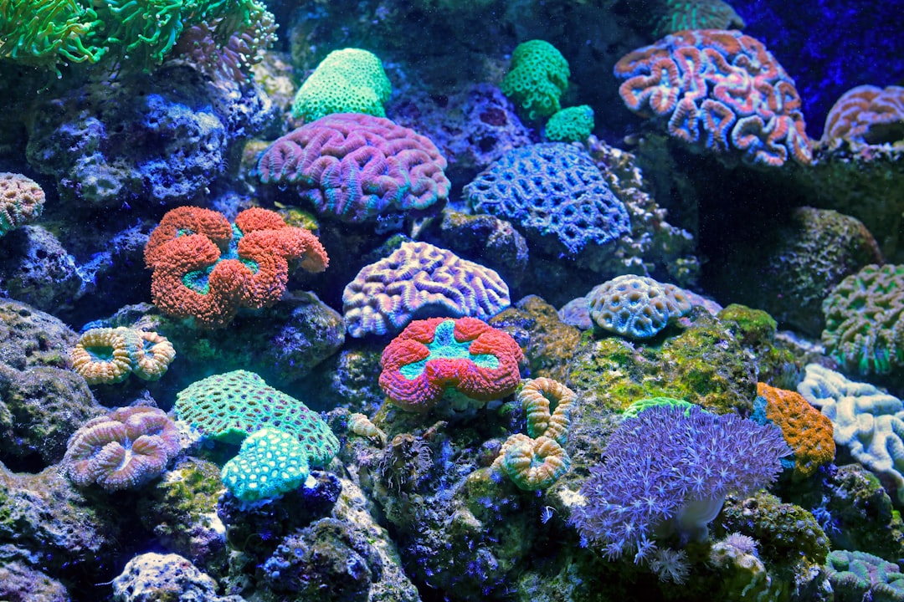

*This post contains affiliate links. As an Amazon Associate, I earn from qualifying purchases at no extra cost to you.*

Target feeding corals is one of the most effective ways to accelerate coral growth, boost coloration, and keep your water parameters stable. Unlike broadcasting food across the entire tank (which benefits fish and raises nutrient levels), target feeding delivers nutrition directly to individual corals through a pipette or turkey baster. This method is especially valuable for non-photosynthetic and deep-dwelling corals that struggle to capture particles in the water column, as well as large polyp stony (LPS) corals and small polyp stony (SPS) corals that benefit from supplemental feeding.

The challenge is knowing which foods actually work, how often to feed, and how to deliver them without creating water quality problems. This guide walks you through the science, techniques, and practical schedules that competitive reef keepers and successful home hobbyists use to feed their corals successfully.

Photo by <a href="https://unsplash.com/@davidclode?utm_source=artlines_blog&utm_medium=referral">David Clode</a> on <a href="https://unsplash.com/?utm_source=artlines_blog&utm_medium=referral">Unsplash</a>

## Why Target Feed Corals in Your Reef Tank

Most reef aquariums receive some nutrient input from fish food and bioload, which soft corals often rely on as their primary food source. However, stony corals - particularly SPS and LPS species - thrive on targeted supplemental feeding because they are more efficient heterotrophs (animals that consume food) than many reefers assume. Research from the [Coral Reef Alliance](https://www.coral.org/?utm_source=artlines_blog&utm_medium=referral) and published studies on coral nutrition show that even photosynthetic corals increase growth rates by 20–40% when provided regular target feeding.

Non-photosynthetic corals - such as black corals, octocorals, and some deepwater species - have no functional [zooxanthellae](https://oceanservice.noaa.gov/facts/coral.html) (the photosynthetic algae that live in coral tissue) and are obligate predators. Without target feeding, they slowly starve in captivity. Similarly, corals kept under lower light conditions benefit enormously from food inputs because they cannot rely on photosynthesis alone.

Target feeding also allows you to control nutrient input precisely. Rather than relying on diffuse fish waste, you add exactly what your corals need in the exact location where they need it. This reduces excess nitrate and phosphate accumulation, which is a major advantage over broadcast feeding. You can also observe which corals are eating and adjust populations or placement based on actual feeding behavior.

## Types of Coral Food for Target Feeding

Coral foods fall into three main categories: liquid concentrates, frozen foods, and pellets. Each has distinct advantages and tradeoffs.

**Liquid concentrates** are the most popular choice for beginners because they are easy to dose and widely available. They typically contain nutrients that corals absorb directly through their tissues and polyp mouths. The [Red Sea Reef Energy Plus 500ml (AB+) All in One Coral Food for Saltwater Aquarium Marine Reef Tanks | Food for Soft, LPS, SPS, and Non-Photosynthetic Corals](https://www.amazon.com/dp/B087BCPVRT?tag=reefcraft-20) is an all-in-one formula designed to feed soft, LPS, SPS, and non-photosynthetic corals. The downside is that liquid concentrates break down quickly in water with high flow, and excess doses can spike ammonia if overfed.

[Two Little Fishies SeaElements Reef Formula for Aquarium, 250ml](https://www.amazon.com/dp/B0006JM0LM?tag=reefcraft-20) has long been a staple in reef keeping and remains a popular choice among hobbyists. It is used as a dedicated reef formula supplement and is a practical option for keepers looking to add a reef formula to their feeding routine.

**Frozen foods**—particularly frozen copepods, mysis shrimp, and rotifers - more closely mimic a coral's natural diet and elicit strong feeding responses in polyps. High-quality frozen feeds contain intact tissue and fats that liquid concentrates cannot provide. The main limitation is that frozen food thaws quickly, becomes diluted by tank water, and can foul the water column if uneaten pieces are not removed. You also need freezer space and must thaw portions before feeding.

**Pellet foods** are newer to the target feeding market but gaining traction with LPS-focused keepers. The [LPS Grow+Color Pellets Coral Food - Fauna Marin](https://www.amazon.com/dp/B00JG4FVKU?tag=reefcraft-20) is specifically formulated for LPS corals and is designed to support both growth and color. Pellet-form foods behave differently in the water column than liquid feeds, making them a distinct target-feeding option for LPS corals.

## Delivery Methods for Target Feeding Corals

How you deliver food matters as much as what you feed. Different delivery methods work better for different coral types and tank setups.

**Pipettes and syringes** are the standard for liquid concentrates and frozen thawed foods. A standard 10ml pipette or 20ml syringe lets you dose food directly into a coral's mouth or onto its polyps. Turn off or reduce powerhead flow, dose the food slowly to give the coral time to capture particles, then turn flow back on. This method gives you complete control and minimizes waste. Most reefers keep a dedicated pipette solely for feeding to avoid cross-contamination with other tank chemicals.

**Turkey basters or fry nets** work well for frozen pellets and larger particles. You can hold the net in front of a coral and watch it feed, removing the net if the coral isn't interested. This is more interactive and lets you observe whether food is actually being consumed. A turkey baster is also useful for gently blowing uneaten particles away from the substrate before they decompose.

**Automatic feeders** exist for reef tanks but are generally not recommended for target feeding because they cannot distinguish between coral species or monitor intake. They are better suited to broadcast feeding for fish and create inconsistent nutrition across different coral types.

**Broadcast feeding** (releasing food into the water column without targeting) is useful as an occasional supplement for a whole tank, but it benefits fish more than corals and raises overall nutrient levels. Reserve this for once or twice per week if at all, and rely on direct target feeding for the bulk of supplementation to your corals.

## Establishing a Target Feeding Schedule for Your Corals

Feeding frequency depends on coral species, tank size, light conditions, and existing nutrient input from fish. Most reefers target 3–5 feeding sessions per week, though competitive keepers may feed daily or twice daily.

**Beginner schedules (3x per week):** Start with feeding every other day. Use a smaller dose (about 1ml of liquid concentrate per 10 gallons of tank volume) and observe how corals respond. This is a conservative approach that minimizes overfeeding and allows you to establish baseline water parameters. Monitor ammonia and nitrite daily during the first 2 weeks.

**Intermediate schedules (4–5x per week):** Increase frequency to every weekday and skip weekends. Dose the same volume as above but more frequently to provide consistent nutrition. This schedule works well for tanks with established protein skimmers and moderate bioload. It requires more attention to water testing but delivers better coral growth than beginner schedules.

**Advanced schedules (6–7x per week or daily):** Only recommended for tanks with excellent skimming, water changes, and stable nutrient export. Competitive keepers feeding toward maximum growth use daily feeds in the morning and evening, carefully monitoring bioload. These schedules are best suited to experienced aquarists with larger tanks (120+ gallons) and dedicated equipment.

Non-photosynthetic corals should be fed at least 5 times per week because they have no photosynthetic input. SPS corals under high light (400+ PAR) can often be fed 3 times per week because they derive energy from zooxanthellae and treat food as supplemental. LPS corals typically benefit most from 4x per week feeding. When in doubt, start at 3x per week and increase only after 4 weeks of stable parameters.

Never feed if ammonia or nitrite is present, and always perform a water change before ammonia rises above 0.25 ppm. Consistent feeding is more important than aggressive dosing; a stable schedule builds better results than sporadic heavy feeds.

## How to Target Feed Corals: Step-by-Step Guide

1. **Turn off or reduce flow.** Turn off circulation powerheads or reduce them to 50% power. High flow will disperse food before corals capture it. Leave the return pump running to maintain surface agitation and oxygen exchange.

2. **Turn off skimmer.** Shut down your protein skimmer for 10–15 minutes. Active skimmers will remove nutrients from the water column before corals can absorb them, wasting your food and money.

3. **Dose food slowly with a pipette.** Draw up 1–2ml of liquid concentrate or thawed frozen food in a 10ml pipette. Place the pipette tip near the coral's mouth or center, and slowly squeeze food into the water. Watch the polyps expand and track the food particles. If polyps don't respond within 30 seconds, move to the next coral.

4. **Wait 10–15 minutes.** Let corals consume food without current pushing it away. During this time, observe which corals are feeding and whether particles are being captured or sinking uneaten. This observation is critical for adjusting future doses.

5. **Turn flow back on.** Resume normal powerhead flow to distribute oxygen and nutrients throughout the tank. Wait 2–3 minutes before restarting the skimmer to allow corals to fully absorb food.

6. **Turn skimmer back on.** Restart your skimmer to begin removing waste products from the feeding session and maintain water quality.

7. **Monitor water quality daily.** Test ammonia and nitrite for 2–3 days after increasing feeding frequency. If either parameter rises above safe levels (ammonia >0.25 ppm, nitrite >0.1 ppm), reduce feeding volume by 25–50% and space feedings further apart.

## Common Target Feeding Mistakes to Avoid

**Overfeeding based on assumption rather than observation.** The most frequent error is dosing the same amount for every coral without checking whether it's actually being consumed. A large fleshy LPS coral will capture more food than a small SPS colony. Watch for uneaten particles sinking to the substrate immediately after feeding - if you see them consistently, you are dosing too much. Reduce volume by 50% and increase frequency instead. Excess uneaten food becomes detritus, drives ammonia spikes, and promotes nuisance algae growth.

**Feeding corals that are not open.** Corals close their polyps for many reasons: poor water quality, low flow, shock from new placement, or simply because they are resting. Feeding a closed coral is futile and wastes expensive food products. Always observe the coral's state before dosing. If a normally open coral is closed regularly, investigate water parameters, placement, and flow before adding more food. Check water temperature, salinity, ammonia, and nitrite before assuming a feeding problem.

**Not accounting for fish feeding.** If your tank has heavy fish loading and you feed fish twice daily, your corals may already be receiving adequate organic input. Adding aggressive target feeding on top of fish feeding can cause rapid ammonia and nitrate accumulation, especially in smaller tanks under 75 gallons. Perform a water change before increasing coral feeding, and adjust fish feeding downward if necessary. In heavily stocked tanks, reduce fish feeding to once daily while ramping up coral feeding.

**Skipping water changes to "save nutrients."** Some hobbyists mistakenly believe that withholding water changes will provide more food for corals by allowing organic matter to accumulate. In reality, nutrient accumulation above healthy levels (nitrate >40 ppm, phosphate >0.15 ppm) inhibits coral calcification, promotes algae blooms, and stresses coral tissue. Maintain regular water changes (20–30% weekly) and feed corals at appropriate levels rather than relying on residual organic matter. Water changes are your best insurance against nutrient creep.

**Failing to dose consistently.** Corals benefit from predictable feeding schedules. Feeding heavily 2 days in a row and then skipping 5 days creates stress and prevents consistent growth. Pick a realistic schedule (3–5x per week for beginners) that you can sustain long-term, and stick to it. Consistency matters more than volume. Set a reminder on your phone to feed at the same time each day, or post a checklist on your tank.

## FAQ: Target Feeding Corals

**Q: Can I target feed corals with fish food?**
Aquarium fish food is designed for fish digestive systems and contains binders that corals cannot process efficiently. High-quality fish food is expensive when used as coral feed, and it breaks down unpredictably in saltwater, often creating excess waste. Use coral-specific products that are formulated with bioavailable amino acids and fatty acids targeted to coral metabolism. Your corals will consume actual coral food far more efficiently, and you will see faster growth and better coloration with less nutrient pollution.

**Q: What is the best coral food for SPS corals specifically?**
SPS corals are photosynthetic and relatively efficient at capturing small particles from water flow. Liquid concentrates like Red Sea Reef Energy or Two Little Fishies SeaElements work well at moderate doses (1ml per 10 gallons, 3x per week). Many SPS-focused reefers also use very small frozen feeds like copepod nauplii because they mimic natural plankton prey and elicit strong feeding responses. The key is avoiding oversized particles that SPS polyps cannot handle. Start with liquid feed and add frozen supplements only after establishing consistent growth.

**Q: How do I know if I am overfeeding my corals?**
Watch for uneaten particles settling to the substrate immediately after feeding - this is the clearest sign of overfeeding. Check ammonia and nitrite daily during the first 2 weeks of a new feeding regimen. If either rises above 0.25 ppm, cut feeding volume in half and space feedings further apart. Also observe coral polyps: if they remain deflated for extended periods between feedings, the tank is not processing bioload efficiently, and you should reduce feeding until water quality stabilizes and polyps recover their normal appearance.

**Q: Can non-photosynthetic corals survive on phytoplankton cultures alone?**
Pure phytoplankton (plant plankton) does not contain sufficient protein and complex lipids for non-photosynthetic corals to thrive. They require zooplankton (animal plankton) like copepods and rotifers. Commercial liquid foods and frozen feeds are formulated to replace these missing zooplankton with concentrated amino acids and fatty acids. If you maintain a phytoplankton culture, use it as a supplement alongside high-quality coral foods, not as a complete replacement for dedicated coral nutrition.

### Conclusion

Target feeding transforms coral growth and coloration when done systematically. The key is matching food type to coral species, using delivery methods that maximize capture, and establishing a consistent schedule that your tank can support without water quality crashes. Refer back to the [LPS Corals For Beginners](/2026/04/07/lps-corals-for-beginners/) guide if you are new to these specific species, as they respond dramatically to proper feeding.

Start conservatively: choose one coral food product from those listed above, pick a schedule of 3 times per week, and observe results for 2 weeks. Monitor your ammonia and nitrite levels. Once you confirm your bioload is stable, increase frequency to 4–5 times weekly if desired. Over time, you will develop an intuition for how much your specific corals and tank can handle.

The corals that thrive under target feeding are your most valuable livestock. Investing the small amount of time needed to feed them properly pays dividends in growth, color, and resilience for years to come.

**Bookmark this guide and revisit it whenever you add new coral species or adjust your feeding schedule.**

### Related Reading

Learn more about feeding and caring for specific coral types in these guides:
- [LPS Corals For Beginners](/2026/04/07/lps-corals-for-beginners/)
- [SPS Coral Basics Water Quality Flow](/2026/04/09/sps-coral-basics-water-quality-flow/)

---

  
<strong>About the Author</strong>

  
The ReefCraft Guide team researches saltwater aquarium keeping, drawing on community-tested methods, manufacturer data, and published marine biology literature. Our guides explain why something works - not just what to do.

