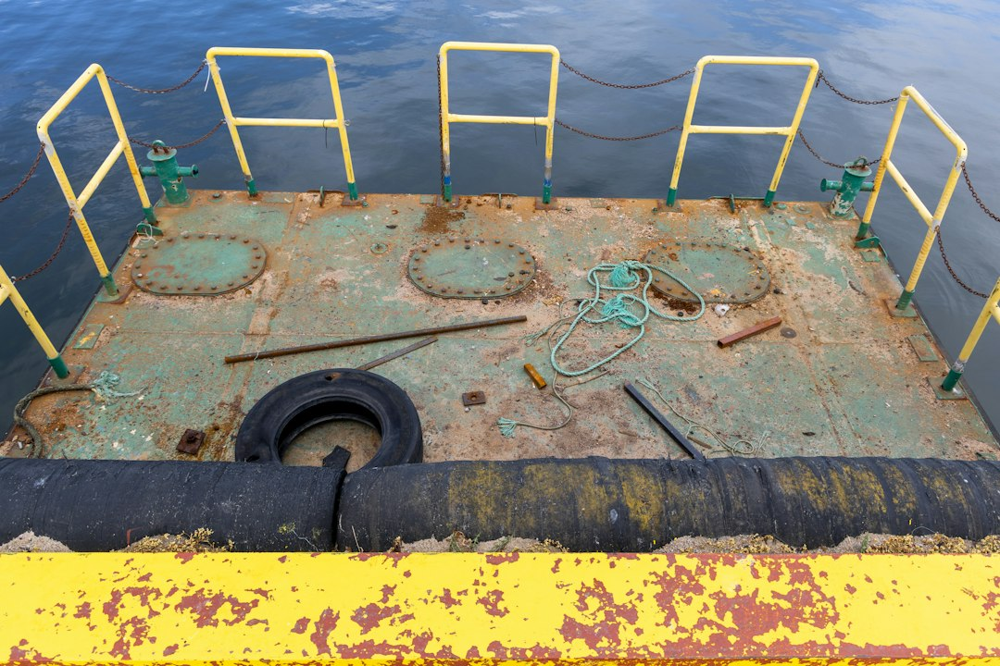

Most reef keepers have a plan for equipment failure that lives entirely in their heads. It says something like "I will grab the battery pump and figure it out." That plan holds up fine until the lights are off, the house is quiet, and you are standing at the tank with a flashlight wondering which of your fifteen cords matters first.

A reef tank power outage is not one problem. It is several problems that arrive together: circulation stops, surface gas exchange drops, heating or cooling stops, and every pump and controller has to come back on in a sensible order. The tank you keep is a closed system that depends on moving water. Your position going in should be simple: independent aeration comes first, written observations come second, and recovery decisions come last, made calmly from notes instead of panic.

This guide gives you a rehearsal you can run while you are present, on a healthy and stable tank, with no deliberate attempt to stress the animals. It also gives you a worksheet to fill in. Nothing here is a claim that a test was run on a specific tank. Every example is labeled as illustrative.

Photo by [Kasia Derenda](https://unsplash.com/@kasiade?utm_source=artlines_blog&utm_medium=referral) on [Unsplash](https://unsplash.com/?utm_source=artlines_blog&utm_medium=referral)

## Why a reef tank power outage rehearsal beats improvising

Rehearsing does not mean breaking your tank on purpose. It means walking through the response while nothing is wrong, so the decisions are already made when something is.

Reef systems are unusually dependent on electricity. A typical setup has a return pump, one or more powerheads, a skimmer, a heater, lighting, possibly a chiller or fan, an auto top-off, and a controller tying some of it together. When mains power fails, all of these stop at once. When it returns, they all start at once, and not always in a safe order. A return pump can restart before the sump level has settled, a heater can come back while water is low, and a controller can fire a dosing or top-off routine based on stale timing.

The point of a rehearsal is to find these gaps. You discover that the battery pump is in a closet you cannot reach quickly, that the airline is too short, or that nobody labeled the power strip. You discover that your notes about the heater are missing because you never wrote them down.

Be wary of any source that gives you a single number for how long a reef can safely go without power. No fixed universal figure exists. Tolerance depends on stocking, temperature, water volume, bioload, how the tank was running beforehand, and what you do during the outage. Treat any confident universal timeline as a red flag. Your own written observations, taken while you are present, are more useful than a borrowed number.

If a past outage or equipment failure already hurt your tank, read [how to recover from a reef tank crash](/2026/04/29/2026-04-29-how-to-recover-from-a-reef-tank-crash/) after this guide. The rehearsal here is about prevention and calm response, not rescue. If you already run controllers, the [reef tank automation guide](/2026/04/23/reef-tank-automation-dosing-pumps-controllers-and-monitoring/) covers how monitoring fits into the picture, and you should check how yours behaves after power loss.

## Backup aeration priorities for a reef tank power outage

Aeration is first because it is the one function you can keep independent of the house. In a power loss, surface agitation and gas exchange are what you most want to preserve, so your first backup purchase or setup choice should be a source of air that does not depend on mains power. This is a principle, not a product recommendation, and nothing in this article endorses a specific model.

### What independent aeration looks like

The common approach is a battery-operated air pump feeding an airline and an air stone, placed so the bubbles disturb the water surface and carry water upward. Some keepers use a pump that can run from several battery types. Others use a small rechargeable unit. The details live in the manufacturer's manual, and that is where you should look for the real specifications, including what the pump is rated for, what batteries it takes, and what the maker says about continuous use.

Do not assume a runtime from a package or a forum post. A stated runtime depends on battery chemistry, battery condition, air stone resistance, and water depth. Write down what your manual actually says, then treat it as a starting point you verify by watching the pump rather than a promise.

### Placement and plumbing details to check

- **Surface disturbance.** Position the air stone where its bubbles break the surface and where the movement can reach water that is otherwise still. The goal is movement at the surface, so place the stone with that in mind.
- **Back-siphon protection.** When an air pump stops, water can travel back down an airline if the pump sits below the waterline. A check valve is the usual safeguard, and the pump manual should tell you whether and how to fit one.
- **Salt creep and clogs.** Air stones in saltwater clog over time. Inspect the stone during your rehearsal and note its condition in the log.
- **Battery storage.** Batteries left inside equipment for long periods can leak or fail. Store them according to the manufacturer's guidance and label the date you checked them.

### Backup power for circulation

A battery backup unit for small pumps is another option, but approach it conservatively. Check the unit's labeled capacity and the labeled power draw of every device you would connect, using the manufacturer's documentation. Many backup units are not intended for heaters or other heating loads, and the manual will say so if that applies. If your documentation does not clearly state that a device is suitable, do not connect it.

If you also have a sump with an overflow, your plumbing determines what happens to water levels when the return pump stops and starts. The [aquarium sump setup guide](/2026/03/11/aquarium-sump-setup-guide/) and the [reef tank plumbing and overflow basics](/2026/05/04/2026-05-04-reef-tank-plumbing-and-overflow-basics-for-beginne/) post both explain why. Confirm that your sump can hold the volume that drains down when the return pump stops, because the rehearsal will not be reliable if you have not worked that out first.

## Electrical safety before you rehearse anything

Electricity and saltwater are a poor combination, and an outage adds improvisation on top of it. Treat this section as non-negotiable.

> **Safety warning:** Keep every plug, power strip, and outlet dry, and keep them above any possible drip or spill. Use appropriate electrical protection, such as a ground-fault circuit interrupter (GFCI) outlet or breaker, for equipment near water, and follow the manufacturer's instructions for each device. Never connect a generator or backup source to household wiring with improvised cords or by "backfeeding" an outlet. That can energize utility lines and injure people. Any generator connection to a home should be done through properly installed equipment by a licensed electrician. Generators must run outdoors and away from windows, doors, and vents because of carbon monoxide risk. If you smell burning, see sparks, or feel a tingle from the water, stop and get professional help. Disconnect only if you can do so safely.

The U.S. Consumer Product Safety Commission publishes [carbon monoxide safety information](https://www.cpsc.gov/Safety-Education/Safety-Education-Centers/Carbon-Monoxide-Information-Center) that covers generator use, and it is worth reading before you ever buy or borrow one. For general outage readiness at home, [Ready.gov's power outage guidance](https://www.ready.gov/power-outages) is a useful government resource. The [Electrical Safety Foundation International](https://www.esfi.org/) is a nonprofit that publishes consumer electrical safety material, including material on protection devices near water.

Also check the exact manuals for your own gear. Manufacturer sites such as [Neptune Systems](https://www.neptunesystems.com/) and [Fluval](https://www.fluvalaquatics.com/) host support documentation for their products, and the same applies to the makers of your own pumps, heaters, and controllers. Use manufacturer sites for manual lookup only, and rely on the document for your exact model, not on a general statement about a brand.

Two equipment rules to build into your plan:

1. **Do not power a heater on while it is out of water.** Heater manuals typically warn against this. If water level has dropped, confirm the heater is fully submerged before it receives power, and follow the manual for your model.
2. **Avoid repeatedly cycling pumps on and off.** Rapid power cycling can be hard on equipment and can produce confusing water-level behavior in a sump. Restore things deliberately, one at a time, as described below.

## The step-by-step reef tank power outage rehearsal

This rehearsal is owner-present on a healthy, stable tank. You are practicing the response, not testing how long animals can cope. Nothing here asks you to create low oxygen conditions. You watch the tank the entire time, you have a stopping rule written down beforehand, and you stop the moment anything looks wrong or you feel unsure.

**Before you start:** pick a time when you are home, rested, and not already dealing with a problem. Do not run it right after adding new livestock, after a large water change, during a disease concern, or when the tank is otherwise unsettled. Tell everyone in the house what you are doing.

1. **Gather your outage kit and put it in one place.** Collect the independent aeration pump, airline, check valve if your manual calls for one, air stone, fresh batteries stored per the manufacturer, a flashlight or headlamp, a notebook or printed log, a pen, and your equipment manuals. Confirm that the manuals are for your exact models.
2. **Fill out the pre-rehearsal sections of your log.** Record the date, time, and your normal readings for temperature and anything else you routinely measure. Write down which fish and corals look normal and how they look when healthy. These are your baseline observations, and they only count if they are real, so measure only what you actually measure.
3. **Photograph your equipment layout.** Take a picture of the back of the stand, the power strips, and the sump so you can restore everything correctly later. Label cords with tape if they are unlabeled.
4. **Set aeration up first, and run it before you change anything else.** Place the air stone, confirm the bubbles are breaking the surface, and confirm the pump runs on its own power. Do this while the normal circulation is still on, so you learn how it behaves with no other change.
5. **Write your stopping rule on the log.** Examples: "Stop and restore normal flow if any animal shows distress, if the aeration pump does anything unexpected, or if I feel uncertain about anything." Do not set a time limit as your only rule, because a timer cannot see what the tank is doing.
6. **If you choose to go further, interrupt circulation briefly, once, and deliberately.** Switch off the mains-powered circulation in the way your manuals describe, with aeration already running. Watch the tank continuously. Do not leave the room. Record what you see at each check, using the log columns below.
7. **Restore power in a planned order, one device at a time.** Confirm the sump level and heater submersion first. Restart the main circulation, then other pumps, then the skimmer, then lighting and the rest, following your manuals. Pause between each device and watch.
8. **Close out the log.** Write down what surprised you, what was missing, and what you would change. Replace used batteries and return the kit to its storage spot.

Step 6 is optional. Many keepers will get most of the value from steps 1 to 5 and step 8 without interrupting anything. If you feel any hesitation about interrupting circulation on your tank, treat that hesitation as a reason to stop at the dry run and revisit later.

## Your observation log and recovery decision worksheet

A log turns an outage from a blur into a record. During stress, memory is unreliable. Writing short entries at set points helps you spot trends and make a calmer decision later.

### The log columns

Use these columns on paper or in a spreadsheet:

| Field | What to write | Why it matters |
|---|---|---|
| Time | Clock time of the check | Lets you see how things changed |
| Power state | Mains on, mains off, partial | Anchors every other note |
| Aeration status | Running, stopped, changed position | Confirms your backup is working |
| Surface movement | What you see at the surface | Shows gas-exchange conditions visually |
| Fish behavior | Normal, unusual, specific notes | Early warning, in your own words |
| Coral and invertebrate appearance | Open, closed, any change | Compare to your baseline notes |
| Temperature | Only if you actually measured it | Record the reading and the method |
| Action taken | What you did | Makes later review honest |
| Decision | Continue, adjust, or stop | Ties the log to your stopping rule |

Only fill in a measurement you actually took. If you did not measure, write "not measured." A blank is honest, and an invented number is dangerous.

### Illustrative example, not an observation

The rows below are made-up entries to show the format. They are not data from any tank and should not be read as typical or expected results.

| Time | Power state | Aeration | Surface | Fish | Action | Decision |
|---|---|---|---|---|---|---|
| (example) 7:00 | Mains on | Backup running | Visible bubbles | Normal | Baseline notes written | Proceed to next check |
| (example) 7:10 | Mains on | Backup running | Visible bubbles | Normal | None | Continue |
| (example) 7:20 | Mains on | Stopped | None | Not checked | Replaced battery | Stop rehearsal, review |

That last row shows how a rehearsal pays off. A stopped backup pump found during practice is a small problem. Finding it during a real outage is a large one.

### A simple recovery decision framework

When power returns, work through these questions in order. This is a decision aid, not a treatment plan.

- **Is the area safe?** Dry plugs, no sparks, no burning smell, no standing water near outlets. If not, stop and call a qualified electrician.
- **Is the water level correct?** Check the display and sump level before restarting anything. A heater must be submerged before it is powered, per its manual.
- **Is aeration still running?** Leave independent aeration on until normal circulation is confirmed.
- **Are any animals showing distress?** If yes, stop the rehearsal or restoration pace, keep aeration going, and consider contacting an experienced reef keeper, a local fish store you trust, or an aquatic veterinarian. This guide does not prescribe treatments.
- **Has everything restarted in the order you planned?** Restore one device at a time and pause between each.
- **What do your readings say?** Use your own test results, and see the [reef tank water chemistry guide](/2026/03/11/reef-tank-water-chemistry/) for what each parameter does. For help choosing kits you can trust, see [best affordable test kits for a reef tank](/2026/04/05/best-affordable-test-kits-reef-tank/).

Keep your printed log with your manuals, in a dry place, and keep a second copy somewhere you can reach without electricity.

## Common reef tank power outage mistakes to avoid

Most outage problems come from preparation gaps and rushed restarts, not from the outage itself.

**Relying on a single memorized plan.** Memory fails under stress. Write the steps down and keep them near the tank. A written checklist is more reliable than your best recollection.

**Trusting a fixed "safe hours" number.** There is no universal figure. Any source that gives one is guessing about your system. Replace the number with continuous observation and a stopping rule.

**Never checking the batteries.** A backup pump with dead or leaked batteries is worse than no plan, because it gives you false confidence. Inspect them on a schedule, store them per the manufacturer, and note the check dates.

**Putting the backup pump somewhere you cannot reach.** If it is buried under supplies, it will not help. Keep the kit where you can find it in the dark.

**Running a heater out of water.** Low water after a power event can expose a heater. Confirm submersion before restoring power and follow the heater's manual.

**Restarting everything at once.** Flipping a power strip back on starts every device together and hides which one caused a problem. Restore devices in order, checking the sump level and the display between each step.

**Cycling pumps repeatedly.** Switching a pump on and off to "see if it works" adds wear and confuses water levels. Make one clean decision and watch the result.

**Improvising generator connections.** Backfeeding a household circuit with a homemade cord is dangerous to you and to utility workers. Use only properly installed equipment, and keep generators outdoors.

**Skipping the log.** Without notes, you will argue with yourself about what happened. Write short entries even when nothing seems to be wrong.

**Ignoring controller behavior.** Some controllers resume schedules or dosing after a restart. Check your manual so a top-off or dosing routine does not fire at the wrong time. The [best auto top-off systems guide](/2026/04/15/best-auto-top-off-systems-saltwater-tanks/) is a useful reference for thinking through what your top-off does when power returns.

## FAQ

### How long can a reef tank safely go without power?

No single answer applies to every tank. Safe duration depends on stocking, temperature, water volume, bioload, and what you do during the outage, so any fixed number is a guess. A better approach is to keep independent aeration running, watch your animals continuously, and act early when you see anything unusual. Your written baseline and your log help you recognize change, and your stopping rule tells you when to quit. When in doubt, restore normal conditions rather than testing limits. If you want to understand your own system, run the owner-present rehearsal rather than relying on a figure from a forum.

### Is a battery air pump enough for a reef tank?

A battery air pump addresses surface agitation and gas exchange, which is the most urgent need in many outages, but it does not do everything. It does not heat or cool, and it does not replace the circulation your return pump and powerheads provide. Whether it is enough for your system depends on your tank, and the manufacturer's manual is the place to check ratings and limits. Treat it as the first layer of a plan that also includes observation, temperature awareness, and a careful restart. Do not rely on a runtime claim you have not verified yourself.

### Should I use a generator during an outage?

A generator can help, but only when used safely. Never backfeed a household outlet or connect it with improvised cords. Use only properly installed transfer or inlet equipment set up by a licensed electrician, and always run generators outdoors, away from windows and vents, because of carbon monoxide risk. The CPSC and Ready.gov pages linked above explain these hazards. Read the generator's own manual before use, and check each aquarium device's manual to confirm it is suitable for the power source. If you are uncertain, consult a qualified professional rather than guessing.

### What if an animal looks stressed during the rehearsal?

Stop the rehearsal, keep aeration running, and restore normal conditions in a planned order. Record what you saw in the log, including the time. Do not continue just to finish the exercise, since the stopping rule exists for exactly this moment. If the problem continues after normal conditions return, talk to an experienced reef keeper, a trusted local fish store, or an aquatic veterinarian. This guide does not prescribe diagnoses or treatments, and the right choice depends on what is actually happening in your tank.

## Conclusion

An outage is not the time to design a plan. Build the kit, write the checklist, and run the dry rehearsal while everything is calm. Put independent aeration first, observe continuously, and let your stopping rule decide when to quit, not a borrowed number. Restore equipment one device at a time, check the sump level and heater submersion before anything gets power, and keep electrical safety ahead of every shortcut.

Your next action is small: print the log table, fill in your baseline, and put the kit in a spot you can find in the dark. Then read your own manuals for the pump, heater, and controller, and note what each one says about power loss.

Bookmark this page so the worksheet is easy to find, and leave a comment if you would like a printable version of the log.

**Related reading:**

- [Reef Tank Maintenance Schedule](/2026/03/11/reef-tank-maintenance-schedule/)
- [Chiller vs Fan Cooling for a Reef Tank](/2026/04/13/chiller-vs-fan-cooling-reef-tank/)

  
<strong>About the Author</strong>

  
The ReefCraft Guide team researches saltwater aquarium keeping, drawing on community-tested methods, manufacturer data, and published marine biology literature. Our guides explain why something works - not just what to do.

