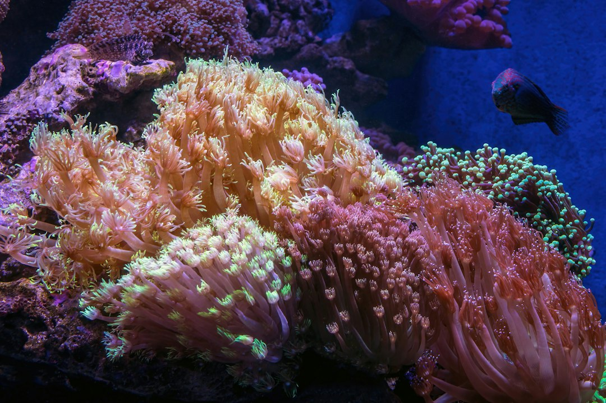

Most reef keepers meet copepods the same way: a small vial arrives, the contents go into the sump, and a few weeks later nobody can say whether the population took hold. Buying a vial now and then is fine as a seeding step. It is a poor long-term feeding strategy, because a one-time release into a tank full of hungry fish, wrasses, and filter-feeding corals rarely builds a lasting population.

Culturing your own gives you control. You decide when to harvest, how much to add, and which species to keep. A small culture station on a shelf can supply a steady stream of live prey for mandarin dragonets, pipefish, small wrasses, and the corals that capture zooplankton. Amphipods add a larger, scavenging prey item that also helps process detritus.

My position is simple: start with one hardy copepod species in one container, keep a written log, and expand only after that culture is stable. Complexity kills most first attempts, not biology.

Photo by <a href="https://unsplash.com/@davidclode?utm_source=artlines_blog&utm_medium=referral">David Clode</a> on <a href="https://unsplash.com/?utm_source=artlines_blog&utm_medium=referral">Unsplash</a>

## Why Culturing Live Copepods Is Worth the Counter Space

Copepods are small crustaceans that form a large share of the zooplankton in marine food webs. Aquaculture hatcheries use cultured copepods as feed for fish larvae, partly because their nutritional profile and movement suit predators that evolved to eat them. The [NOAA Fisheries aquaculture program](https://www.fisheries.noaa.gov/topic/aquaculture) describes how marine hatcheries depend on live feeds, and the same logic applies on a smaller scale in a reef tank.

For a hobbyist, three practical benefits stand out.

**Feeding picky eaters.** Mandarin dragonets and some pipefish naturally graze on live copepods and often struggle on prepared foods. A culture can provide a more dependable supply than a tank's own population, which these fish can deplete.

**Natural feeding behavior.** Live prey moves, hides in rockwork, and triggers hunting behavior. That is a welfare benefit for fish that would otherwise sit and wait for food to drop.

**Stocking the tank's own food web.** Copepods that escape predation reproduce in the rock and sand. Amphipods graze on film algae and detritus, making them part of the unofficial cleanup crew. The [Live Rock Guide](/2026/03/11/live-rock-guide/) explains why porous rock matters here, since it provides the shelter that lets small populations survive.

The main tradeoff is attention. A culture is a living system that needs feeding, clean water, and regular checks. If you travel often or dislike routine, a refugium that produces pods passively may suit you better. If you want measurable control over supply, a dedicated culture is the better route.

Be realistic about scale, too. A home culture will not replace all feeding for a heavily stocked tank, and no source can promise a specific population size or fish outcome. Treat cultured pods as a supplement and a population seeder, not a complete diet.

## Choosing Species: Copepods, Amphipods, and Which Fits Your Goal

Species choice determines nearly everything else, from container shape to feeding. The common hobby options fall into a few groups.

**Tisbe (benthic harpacticoid).** Tisbe species live on surfaces rather than swimming in open water. They are widely sold for reef use and are generally regarded as forgiving. They settle into rock and sand, so they suit seeding a tank's long-term population.

**Tigriopus (tide pool copepod).** Tigriopus species come from tide pools, which experience swings in salinity and temperature. That heritage is why suppliers often describe them as hardy culture animals. They are larger than many other pods, which suits bigger mouths, though they may be less likely to persist in a tank with active predators.

**Apocyclops (cyclopoid).** These swim in the water column and are often used for feeding fish and coral. Their small nauplii (larvae) are useful for fish with tiny mouths. They generally prefer warmer conditions, so check a supplier's care sheet.

**Calanoids such as Parvocalanus.** These are the traditional hatchery feed for finicky marine fish larvae, but they are often considered harder to culture and need a steady supply of live phytoplankton. They are not a good first project.

**Amphipods.** Marine gammarid-type amphipods are larger scavengers that you can raise in a separate container with macroalgae and fine detritus. They are an excellent food for larger fish such as some wrasses, but they can also nibble on soft tissue in a stressed tank, so introduce them with some thought.

### A simple decision framework

- **Goal is a mandarin or pipefish supply:** start with a hardy harpacticoid or Tigriopus culture, keep a second container going as insurance.
- **Goal is seeding the sump or refugium:** choose a benthic species like Tisbe and add it at night with the lights off.
- **Goal is feeding corals and small fish:** a swimming species like Apocyclops fits, since it stays suspended in flow.
- **Goal is larger food for wrasses:** culture amphipods in their own container, away from the copepods.

Whatever you pick, buy from a supplier that identifies the species and provides a care sheet. [Reed Mariculture](https://reedmariculture.com/) is one example of an aquaculture company that publishes culture information for feed organisms. Use any supplier's own temperature and salinity ranges rather than a generic number from a forum thread.

## Culturing Live Copepods Step by Step

Equipment is simple. You need a clear container with a lid, a small air pump with airline tubing and an air stone, a heater only if your room is cold, marine water mixed to the supplier's recommended salinity, a source of food, and fine mesh for harvesting. No specific brand is required, and a basic setup works for the first attempt.

**Electrical safety:** Air pumps and heaters sit near water. Keep plugs and power strips above the waterline, use a drip loop in cords, and plug equipment into a GFCI-protected outlet. Never handle a plugged-in heater with wet hands.

### Food for the culture

Most cultures run on live or concentrated phytoplankton such as Nannochloropsis, Isochrysis, or Tetraselmis. Some benthic species also accept very fine prepared foods, but overfeeding fouls the water fast. Follow the supplier's guidance on food and quantity, then adjust from what you see.

### The numbered process

1. **Prepare clean water.** Mix marine salt with dechlorinated or reverse osmosis water to the salinity your supplier recommends. Let it mix and settle, and confirm the reading with a refractometer you have checked against calibration fluid.
2. **Set up the container.** Rinse with plain water only, no soap or cleaning chemicals. Fill it, add gentle aeration, and place it out of direct sunlight. Aeration should create a slow roll, not a violent churn.
3. **Add the starter culture slowly.** Float the shipping bag to match temperature, then drip a little culture water in before pouring the contents into the container. Record the date and species in your log.
4. **Feed lightly.** Add a small amount of phytoplankton so the water becomes only faintly tinted. A tank that is still cloudy the next day received too much.
5. **Observe daily.** Look at the container with a flashlight against a dark background. You are looking for movement, egg-bearing females, and tiny nauplii. A good sign is an increase in visible animals across a couple of weeks.
6. **Do partial water changes.** Replace a portion of the water with fresh matching saltwater on the schedule your supplier suggests. Siphon waste from the bottom with airline tubing.
7. **Start a backup culture.** Once the first container is stable, split a portion into a second container. If one crashes, the other is your recovery.
8. **Harvest only a fraction.** Take a portion of the population, not all of it, so the culture keeps reproducing.

Keep the container covered. Evaporation raises salinity, and a lid also reduces contamination from airborne debris. Top off with fresh water, not saltwater, to replace evaporation, which is the same principle described in the [Best Auto Top Off Systems for Saltwater Tanks](/2026/04/15/best-auto-top-off-systems-saltwater-tanks/) guide.

## Harvesting and Delivering Pods to Your Reef

A culture is only useful if the pods reach the tank in a form your livestock can use. Two issues matter: separating pods from culture water, and timing the feed.

### Separating pods from culture water

Culture water carries phytoplankton, waste, and organic compounds you do not want in your display. Pour the culture through a fine mesh sized to retain the pods, then rinse them briefly with a little tank water or matching saltwater. Swirl them into a clean cup, then add that to the tank. Mesh size depends on your species, and a mesh that holds adults may pass nauplii, so it is worth verifying with a small sample before you pour the main batch.

Never pour unfiltered culture water into a reef. A dense, nutrient-rich culture can raise nutrients, and the guidance in [How to Control Nitrates and Phosphates in a Reef Tank](/2026/05/18/2026-05-18-how-to-control-nitrates-and-phosphates-in-a-reef-tank/) applies to anything you add.

### Timing the feed

A common approach is to feed in the evening, since many pods hide by day and fish settle into rest at night. Check your equipment manuals before pausing any pump or skimmer. Some manufacturers advise against repeated start-stop cycling, so a single brief pause is generally more reasonable than repeated switching. Restart everything promptly and confirm normal flow before leaving the tank.

If you have a refugium, release some pods there rather than in the display. Pods sheltering in macroalgae can breed and spill into the system over time. The [Refugium Setup Guide](/2026/03/11/refugium-setup-guide/) covers lighting, flow, and algae selection for that purpose.

### Target feeding

For corals, you can mix harvested pods into a small cup and use a pipette near the colony with pumps briefly reduced. The [Target Feeding Corals](/2026/08/16/target-feeding-corals-food-types-delivery-methods-and-feeding-schedules/) post covers food types and delivery methods in more detail. Start with small amounts and watch the response. Not every coral will eat pods, and appetite varies by species and condition.

### Amphipods

Amphipods can be netted and fed directly to larger fish, or released into the refugium. Introduce them cautiously. If a tank has soft corals or clams that are already stressed, scavenging amphipods may add to the problem. Pests can also hitch rides on macroalgae, so check what comes in. The [Common Reef Tank Pests](/2026/03/26/common-reef-tank-pests/) guide helps you tell a beneficial scavenger from an unwanted hitchhiker.

## A Culture Log and Decision Worksheet You Can Copy

Culture failures are usually diagnosed too late because nobody wrote anything down. A simple log lets you connect cause and effect. Copy this table into a notebook or spreadsheet.

| Date | Species | Container | Salinity reading | Feed type and amount | Visible activity (low, medium, high) | Water change | Harvest amount | Notes |
|---|---|---|---|---|---|---|---|---|
| (fill in) | | | | | | | | |

**An illustrative example, not a measurement:** Imagine a log entry for a Tisbe starter culture in week two. The keeper writes "faint green tint, lots of movement on the glass, water smells clean, harvested a small spoonful, water change done." That sample is invented to show the style of note. It does not describe a real culture, and your own results will differ.

### Decision prompts

Review your log weekly with these questions:

- **Is activity rising, flat, or falling?** Rising means you can harvest a little more. Falling means stop harvesting and look for a cause.
- **Did the water smell sour or look cloudy?** If yes, cut feeding and check aeration.
- **Did salinity drift?** Evaporation is a common cause. Adjust with fresh water.
- **Is the backup culture healthy?** If both containers are declining, check water source and food quality.
- **What did the tank do after a feeding?** Note fish behavior and any change in nutrient test results. Use your own test kit, and compare against the baseline you recorded before you started adding pods.

### Keep observations separate from assumptions

Write what you saw ("many small animals on the glass at night") separately from what you think it means ("population is growing"). Counting under a flashlight is rough. Without a microscope or a defined counting method, treat activity levels as relative impressions, not numbers.

## Common Mistakes When Culturing Live Copepods and Amphipods

Most failed cultures trace back to a short list of errors. Here is what to avoid.

**Overfeeding.** More food does not make more pods. Excess phytoplankton or flake decays, depletes oxygen, and invites ciliates and bacterial blooms. Feed lightly and watch the water, not the calendar.

**Skipping aeration or using too much.** Stagnant water drops in oxygen. A violent bubble stream stresses delicate nauplii. Aim for gentle, steady movement.

**Using only one container.** A single culture is a single point of failure. Even a small second jar protects your investment.

**Harvesting too hard.** Taking most of the population leaves too few breeders. Remove only a portion, and pause harvests if numbers fall.

**Letting salinity drift.** Lids help, but evaporation still happens. Check salinity regularly, and top off with fresh water.

**Mixing species too early.** Different pods compete, and one may outgrow the others. Keep species in separate containers until you understand each one.

**Pouring culture water into the tank.** This adds nutrients and unknown organisms. Strain and rinse first.

**Introducing hitchhikers.** Wild-collected material, live algae, or water from another tank can carry pests or pathogens. Source starter cultures from a supplier and quarantine anything else.

**Assuming a feed guarantees results.** A tank with aggressive predators may consume pods immediately. If your fish seem thin or ignore the offering, review overall feeding and health, and consult a qualified aquatic veterinarian or experienced local keeper for livestock concerns. Do not rely on a pod culture to solve a health problem.

**Troubleshooting a crash.** If activity drops suddenly, check for temperature swings, a failed air pump, a salinity change, or an accidental cleaner residue in the container. Start a new container from your backup, and write down what changed. If no backup exists, contact your supplier for a replacement and review the log for clues.

For general water quality background, the [Reef Tank Water Chemistry](/2026/03/11/reef-tank-water-chemistry/) guide covers the parameters worth understanding.

## FAQ

### How long does it take for a copepod culture to become productive?

Timelines vary by species, temperature, food, and starting numbers, so no honest source can promise a fixed number of days. Many hobbyists plan on a few weeks of patience before harvesting regularly. Early on, focus on keeping the water clean, feeding lightly, and watching for egg-bearing females and small nauplii, which signal reproduction. Your supplier's care sheet is the best guide for your species. Resist the urge to harvest early, since taking animals before the population grows can stall the culture. Use your log to confirm that activity rises over time before you commit to a harvest schedule.

### Can I just add pods to my tank and skip the culture?

You can, and seeding a tank with a purchased vial is a reasonable starting point. The limit is that a reef with fish, corals, and active predators may consume pods faster than they breed. A dedicated culture lets you deliver more animals on your own schedule and keeps a reserve in case the display population drops. A refugium offers a middle path, since it shelters pods and lets them reproduce passively. The best choice depends on your livestock, your available space, and how much routine maintenance you are willing to take on.

### Are amphipods safe for a reef tank?

Marine amphipods are generally regarded as scavengers that graze on detritus and algae, and many keepers welcome them. The risk is that large populations or stressed, weakened livestock can create problems, since some may nibble on tissue that is already compromised. Observe how your tank responds after introduction. Also confirm what you are adding, because unidentified hitchhikers can include pests. Source cultures from a reliable supplier, and use the pest identification information in your reference guides. If you notice damage to coral or clams, remove the amphipods from the display and reassess.

### Do I need a microscope to run a culture?

No. A flashlight, a clear container, and a dark background are enough to judge activity, and a simple magnifier can help you see egg sacs and nauplii. A microscope lets you identify species and count more accurately, which matters for research or breeding projects, but it is optional for a home feeding culture. What matters more is a consistent log and clean routines. If you do want counts, develop a repeatable method, such as sampling a fixed volume of water, and label the result as an estimate. Do not treat rough counts as precise measurements.

### Conclusion
A copepod and amphipod culture is a modest project with a real payoff: a natural, live food source that you control. Start with one hardy species in one clean, lidded container with gentle aeration, feed lightly, and keep a written log from the first day. Add a backup container once the first one proves stable, and harvest only a portion at a time. Always strain and rinse before adding pods to the display, and follow your equipment manuals when you pause any pump. This week, pick your target species, read the supplier's care sheet, and print the log table so it is ready when your starter culture arrives.

If this guide helped, bookmark it and share your culture setup questions in the comments.

### Related Reading
- [Best Clean Up Crew Reef Aquarium](/2026/03/30/best-clean-up-crew-reef-aquarium/)
- [Common Reef Tank Pests](/2026/03/26/common-reef-tank-pests/)

  
<strong>About the Author</strong>

  
The ReefCraft Guide team researches saltwater aquarium keeping, drawing on community-tested methods, manufacturer data, and published marine biology literature. Our guides explain why something works - not just what to do.

