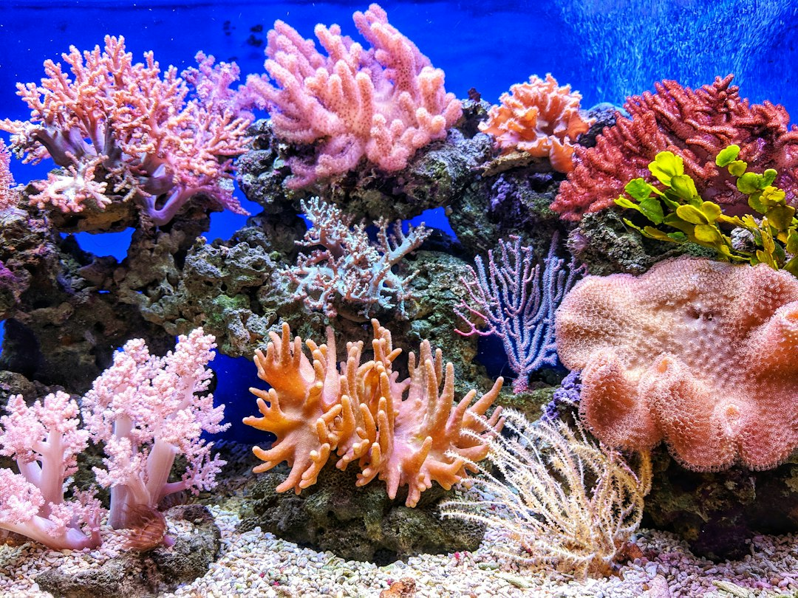

Dirty glass is the most visible chore in reef keeping, and it is also where small shortcuts do the most lasting damage. A grain of sand trapped under a pad can leave a scratch that stays for the life of the tank. A sprayed glass cleaner can dump chemicals into a system that holds corals sensitive to trace contaminants. A stubborn spot scraped with the wrong blade can gouge acrylic in seconds.

The right approach is simple: match the tool to the surface, clean the glass while you manage the algae behind it, and never let anything from outside the tank touch the water. Glass and acrylic need different handling, and the algae growing on them tells you about your nutrients, light, and flow. For most beginners, the best routine is a short, gentle wipe every few days instead of an aggressive scrub once a month.

This guide covers the surface differences, tools by category, a numbered cleaning routine, algae types, a decision log you can copy, and the mistakes that cause the most damage. It does not recommend specific products, since the right choice depends on your tank's material and thickness. Check your tank maker's care instructions before using any tool.

Photo by <a href="https://unsplash.com/@quinguyen?utm_source=artlines_blog&utm_medium=referral">qui nguyen</a> on <a href="https://unsplash.com/?utm_source=artlines_blog&utm_medium=referral">Unsplash</a>

## Know What You Are Cleaning: Glass vs. Acrylic and What Grows on Them

Before you pick up any tool, identify your tank material. Most people know, but plenty of used tanks and all-in-one systems leave owners guessing. Glass is hard and scratch resistant, though it can still be scratched by trapped grit. Acrylic is lighter and clearer, but far softer, so it scratches more easily and needs gentler tools.

If you are unsure, look at the corners and the edges. Glass tanks usually show visible silicone seams and a slight green tint along the cut edge. Acrylic tanks tend to have bonded seams that look like a clear weld and a more neutral edge. Your tank's manual or the manufacturer's support page is the reliable way to confirm.

### What the film on the glass usually is

The coating that appears on reef glass is not one thing. Common types include:

- **Diatoms:** a brown, dusty film, often in newer tanks or tanks with silicate in the water.
- **Green spot algae:** hard, round green dots that resist a soft wipe.
- **Green film algae:** a thin, soft green layer that wipes off easily.
- **Cyanobacteria:** slimy, often reddish or dark mats that can smell earthy.
- **Coralline algae:** pink, purple, or reddish crusts that are desirable on rock but can spread to glass.

Coralline is the one that surprises people. It is a sign of a healthy reef, but on glass it forms a hard crust that is difficult to remove. Many keepers choose to leave a small patch in a back corner and keep the viewing panes clear.

### Why it matters beyond looks

A thin film on glass reduces light entering the tank and hides what is happening inside. More important, the type of growth is diagnostic. A sudden wave of diatoms, green spot, or cyanobacteria usually points to a change in nutrients, light schedule, or flow. Cleaning the glass is a good moment to note what grew and how fast, because that information helps you adjust the system. Our [controlling algae in a reef tank](/2026/03/16/controlling-algae-in-reef-tank/) guide covers the root causes in more depth.

## Tools to Clean Reef Tank Glass Safely

You do not need many tools. You need the right categories and clean, grit-free versions of them. This section describes types of tools rather than brands, because the best fit depends on your tank's size, glass thickness, and substrate.

### Magnetic cleaners

A magnetic glass cleaner has two halves, one inside the tank and one outside, held together by magnetic force. They are convenient for routine wipes and keep your hands out of the water. The main risk is grit. If a grain of sand or a snail shell fragment gets pulled between the inner pad and the glass, it can scratch as you drag it.

To limit that risk, keep the inner half away from the sand bed, rinse it before each use, and move it slowly. Tanks with a thick glass panel may need a stronger magnet, while thin or small panels can pinch a weak one. Manufacturers such as [Tunze](https://www.tunze.com/) and [Mag-Float](https://www.magfloat.com/) publish instructions, size guidance, and warnings on their own sites. Read the current documentation for your model rather than relying on a generic rule.

### Algae scrapers and blades

Plastic scrapers are safer for acrylic and useful on glass for stubborn spots. Metal razor blades are suitable only for glass, and many tank makers caution against using them near silicone seams. Hold a blade flat, keep the surface wet, and never use a blade on acrylic. A chipped or dull blade can scratch glass as well, so replace it often.

### Pads and sponges

Use pads made for aquarium use. Avoid anything labeled as a kitchen scouring pad, or any sponge that has touched soap, detergent, or household cleaners. Keep your reef pads in a separate labeled container. Rinse them in dechlorinated or RO/DI water between uses, and let them dry. Replace a pad if you see embedded grit or the surface feels rough.

### Cloths for the outside

For exterior glass, use a clean, soft microfiber cloth with plain water. Hard-water spots from splashes can be wiped with a cloth dampened with white vinegar mixed with water, but keep vinegar away from the tank opening and from any acrylic unless the manufacturer says it is safe. Never spray cleaner toward an open tank. Spray it onto the cloth away from the aquarium, then wipe.

### Gloves and hand safety

Gloves are a practical choice for reef work. Some soft corals, including zoanthids, can produce toxins that irritate skin or eyes if handled or if contaminated water reaches a cut. Wear nitrile gloves when you reach in, avoid touching your face, and wash your hands afterward. The [CDC's Healthy Pets resources](https://www.cdc.gov/healthy-pets/) include general guidance on hygiene around aquarium water.

## How to Clean Reef Tank Acrylic Without Scratching It

Acrylic tanks reward patience. They scratch easily, but with the right habits they stay clear for years. Plastics manufacturers consistently recommend gentle, non-abrasive cleaning and plain water or manufacturer-approved cleaners, and warn against ammonia-based and solvent-based products on acrylic. Check your tank maker's instructions for the exact guidance on your model.

### Tools that fit acrylic

Choose soft pads and cloths designed for acrylic, plastic or felt-faced magnetic cleaners, and plastic scrapers. Many acrylic tank owners keep a dedicated pad set that never touches the sand bed. Avoid anything that has been dragged along the substrate, because one hard grain can leave a visible line.

### The wet-surface rule

Always clean acrylic while it is wet. Dry wiping can drag dust and particles across the surface and create fine scratches. If you need to wipe the outside of an acrylic tank, rinse the cloth first, let the surface stay damp, and use light pressure. Never use paper towels, which can be abrasive on soft plastic.

### Handling scratches

Light scratches on acrylic can sometimes be polished out with products made specifically for acrylic, but this is a judgment call. Polishing near the waterline or inside a running reef carries chemical risk, and deep scratches may need professional repair. Do not improvise with toothpaste, household polishes, or abrasives. If you see a deep scratch, document it with a photo and ask the tank manufacturer or a reputable repair service what is safe.

### Seams and edges

Whether your tank is glass or acrylic, avoid scraping directly on seams. On glass tanks, a blade can nick silicone. On acrylic tanks, pressure near bonded seams can stress the joint over time. Use a soft pad or plastic edge in corners, and accept that a small amount of algae in a corner is better than a damaged seam.

## Step-by-Step: How to Clean Reef Tank Glass During Routine Maintenance

This routine works for most reef tanks and can be adapted for acrylic by swapping in the gentler tools above. It assumes a healthy, established system. The goal is to remove algae from the viewing panes while keeping debris from settling on corals.

1. **Prepare your tools.** Rinse the pad, scraper, and magnetic cleaner in clean dechlorinated or RO/DI water. Check them by touch for grit. Lay a towel under the work area to catch drips.
2. **Protect electrical equipment.** Keep power strips, plugs, and controllers off the floor and away from the splash zone. Use a drip loop on each cord. Plug equipment into a ground fault circuit interrupter (GFCI) outlet, and consult the [U.S. Consumer Product Safety Commission](https://www.cpsc.gov/) for general electrical safety information. If anything gets wet, do not touch it with wet hands. Dry your hands first and follow the manufacturer's instructions.
3. **Check the equipment manuals.** Before turning off or moving any pump, wavemaker, or heater, read what the manufacturer says. Do not switch heaters on while they are out of water, and avoid repeatedly cycling pumps on and off. A short pause in flow while you clean is common, but follow the instructions for your equipment.
4. **Put on gloves and move corals out of the way if needed.** Look for sessile animals, snails, and anemones near the glass. Do not scrape over them. Wipe around them, or leave a small patch.
5. **Start at the top and work down.** Use slow, overlapping strokes. Let the pad do the work. If a spot resists, switch to a plastic scraper. On glass, use a blade only if you are certain the tank is glass and you can hold the blade flat.
6. **Let the debris settle or be removed.** Algae scraped off the glass will drift. Leave your flow on, and let the skimmer, filter sock, or a gentle siphon remove it. If a lot of algae came off, consider a quick pass with a siphon or turkey baster.
7. **Rinse the tools and wipe the outside.** Clean the exterior glass with a damp microfiber cloth. Rinse your tools and let them dry.
8. **Log what you saw.** Note the type, amount, and location of algae, along with any changes. This is the habit that turns cleaning into diagnosis. The log template in the next section makes it easy.

### How often to clean

Frequency depends on the tank. Some keepers wipe a small amount every two or three days, while others do a full cleaning weekly with water changes. A schedule is useful, so tie it to your normal routine. Our [reef tank maintenance schedule](/2026/03/11/reef-tank-maintenance-schedule/) shows how glass cleaning fits alongside testing, feeding, and water changes.

## Algae Removal on Glass: Matching Method to Type, Plus a Decision Log

Different algae call for different handling. The table below summarizes common types. These are general patterns, not diagnoses, and your tank may behave differently.

| Growth on glass | How it usually looks | Typical removal approach | What it may be hinting at |
|---|---|---|---|
| Diatoms | Brown dust, wipes off easily | Soft pad or magnetic cleaner | Often seen in newer systems or with silicates |
| Green film | Thin, soft green haze | Soft pad | Light, nutrients, or normal early growth |
| Green spot | Hard green dots | Plastic scraper, or blade on glass only | Nutrient and light balance, phosphate levels |
| Cyanobacteria | Slimy mats, may be reddish or dark | Siphon out, then pad | Low flow areas, excess organics |
| Coralline | Pink or purple crust | Scraper on glass, or leave it | Usually a healthy sign, but spreads |

### Removing, not just spreading

The biggest algae mistake is wiping it into the water column and leaving it there. Whenever possible, siphon or filter what you remove. For cyanobacteria especially, remove the mats physically rather than smearing them around. If nutrients are high, algae will return, so cleaning is only half the job. Read [how to control nitrates and phosphates in a reef tank](/2026/05/18/2026-05-18-how-to-control-nitrates-and-phosphates-in-a-reef-tank/) for the nutrient side.

### An original glass cleaning decision log

Copy this into a notebook or a spreadsheet. It turns a chore into a record you can use to spot patterns. The entries below are blank on purpose. Any example you fill in should be labeled as your own observation, not copied from a guide.

**Tank details (fill in once):**
- Tank material (glass or acrylic):
- Panel thickness (from the manual):
- Cleaning tool types in use:
- Manual or support page used to confirm tool safety:

**Per-cleaning entry:**

| Date | Tool used | Growth type seen | Location | Amount (light, moderate, heavy) | Anything near the glass (corals, snails) | Notes on what was removed | Follow-up action |
|---|---|---|---|---|---|---|---|
| | | | | | | | |

**Decision prompts to answer after each entry:**
1. Did the growth return faster than last time, slower, or about the same?
2. Did I check my tool for grit before using it?
3. Did I remove the algae from the water, or leave it to drift?
4. Is there a pattern linked to feeding, lighting changes, or water changes?
5. Do I need to test for nutrients, or adjust a schedule?

**Illustrative example only (not an observation):** Suppose a keeper notes "diatoms, back glass, moderate" in three consecutive entries after adding new sand. That pattern would be a reason to read about silicates and new-tank cycling, not proof of a cause. Treat any log as a prompt for investigation. Pair it with test results from a reliable kit. If you need help choosing one, our [best affordable test kits for reef tanks](/2026/04/05/best-affordable-test-kits-reef-tank/) guide covers the options.

## Common Mistakes That Scratch Glass or Hurt Your Reef

Most glass and acrylic damage comes from a handful of repeat errors. Avoid these and you will avoid most problems.

**Using household cleaners near the tank.** Window sprays, soaps, and detergents leave residues that can harm corals and fish. Even a small drip into the tank can be a problem. Keep household cleaners out of the room when possible, and use plain water for the inside surfaces.

**Dragging grit across the surface.** This is the leading cause of scratches. Sand, crushed shell, and dried salt can all act as abrasives. Rinse tools before every use and keep them away from the sand bed.

**Using a blade on acrylic.** Blades are only for glass. On acrylic, they will cut into the surface. If you are not sure which you have, use a plastic scraper.

**Pressing too hard.** Pressure does not remove algae faster, it removes the surface faster. Use light strokes and let a softer tool work, or switch to a scraper for stubborn spots.

**Cleaning dry acrylic.** Dry wiping can drag dust and create fine scratches. Keep the surface wet and the cloth clean.

**Ignoring the corals.** Scraping near a coral or anemone can irritate it or release toxins. Wear gloves, move slowly, and stop if you see signs of stress such as retracted polyps or unusual mucus.

**Leaving algae floating.** Removing algae from glass and leaving it in the water just redistributes it. Siphon, filter, or net what you can.

**Skipping electrical caution.** Water and electricity do not mix. Keep cords on drip loops, power strips elevated, and plugs dry. Use GFCI protection, and avoid touching equipment with wet hands. If something gets wet, stop and follow the manufacturer's instructions. Do not open equipment or attempt electrical repairs yourself. Contact the maker or a qualified professional.

**Over-cleaning instead of fixing the cause.** If you are scrubbing glass daily to keep up, the glass is not the problem. Review lighting duration, feeding, flow, and nutrient export. The [reef tank water changes](/2026/03/28/reef-tank-water-changes/) guide is a good place to start.

## FAQ

### Can I use a razor blade on my reef tank glass?

Only on glass, and only if you are sure of the material. Hold the blade flat against a wet surface, avoid seams, and never use a blade on acrylic. Check your tank maker's instructions, since some caution against blades on coated or specialty glass. A plastic scraper is the safer default for most beginners, and it handles most algae when used with a bit of patience. Replace blades when they dull or chip, because damaged blades can scratch even tough glass. If you are unsure of your tank's material or the manufacturer's guidance, skip the blade and use a plastic scraper or a soft pad instead.

### Is vinegar safe to use on my tank?

Diluted white vinegar is commonly used on the outside of glass to remove hard-water or salt spots, applied with a cloth. Keep it away from the water and from the tank opening, and rinse the cloth before wiping again. Do not assume vinegar is safe for acrylic, since some plastics react to acidic or solvent-based products. Check the tank manufacturer's care instructions first. For the inside of the tank, stick to plain water and aquarium-safe tools. If you need to clean something that comes into contact with tank water, rinse it thoroughly with clean water before use.

### How do I clean acrylic scratches?

It depends on how deep the scratch is. Very light surface marks may respond to products made for acrylic, used according to the label and the tank maker's guidance. Deep scratches usually will not buff out safely, and polishing inside a running reef risks chemical contamination. Document the scratch with a photo, and contact the tank manufacturer or a reputable acrylic repair service before attempting a fix. Avoid household abrasives, toothpaste, or kitchen polishes. Prevention is far easier: keep tools clean, keep the surface wet, and use gentle pressure.

### How often should I clean the glass?

There is no single schedule that suits every tank. A new system may need frequent wipes, while a mature, balanced system may need less. Many keepers wipe lightly every few days and do a fuller cleaning with water changes. The better question is why the glass is getting dirty so quickly. Use the decision log to track how fast growth returns, and review lighting, feeding, and nutrient levels if it is faster than you expect. Consistency matters more than intensity, and a short, regular wipe is gentler on both the glass and the tank.

### Do magnetic cleaners scratch glass?

They can, if grit gets between the pad and the glass. Rinse the inner half before each use, keep it away from the sand bed, and move it slowly, especially near the bottom. Strong magnets on thin glass can also pinch or create uneven pressure, so follow the manufacturer's size and thickness guidance. If you hear grinding, stop immediately and check for debris. For acrylic tanks, use only magnetic cleaners designed for acrylic, and consider a plastic scraper for stubborn spots.

## Your Next Cleaning: Start Small and Keep a Record

Clean glass comes from consistency, not force. Confirm your tank material, choose tools designed for it, keep them free of grit, and wipe a little and often. Remove what you scrape off, keep electrical safety in mind, and use the decision log to learn what your algae is telling you.

For your next step, take ten minutes this week to check your tank manual, rinse and inspect your cleaning tools, and start a log entry. If the glass is dirtier than you would like, treat that as information. A short log, a few water tests, and a review of your routine will do more than any scrubbing technique.

Bookmark this guide for your next maintenance day, and leave a comment with the cleaning questions you would like covered next.

### Related reading

- [Reef Tank Water Changes](/2026/03/28/reef-tank-water-changes/)
- [How to Control Nitrates and Phosphates in a Reef Tank](/2026/05/18/2026-05-18-how-to-control-nitrates-and-phosphates-in-a-reef-tank/)

  
<strong>About the Author</strong>

  
The ReefCraft Guide team researches saltwater aquarium keeping, drawing on community-tested methods, manufacturer data, and published marine biology literature. Our guides explain why something works - not just what to do.

